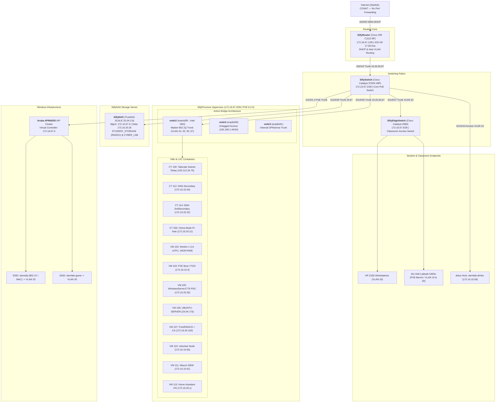
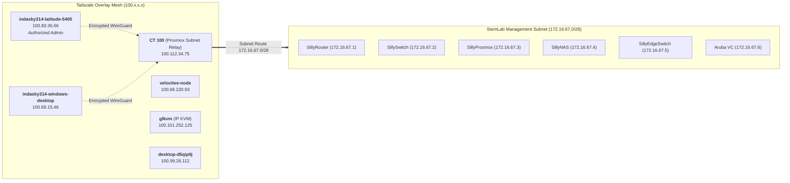
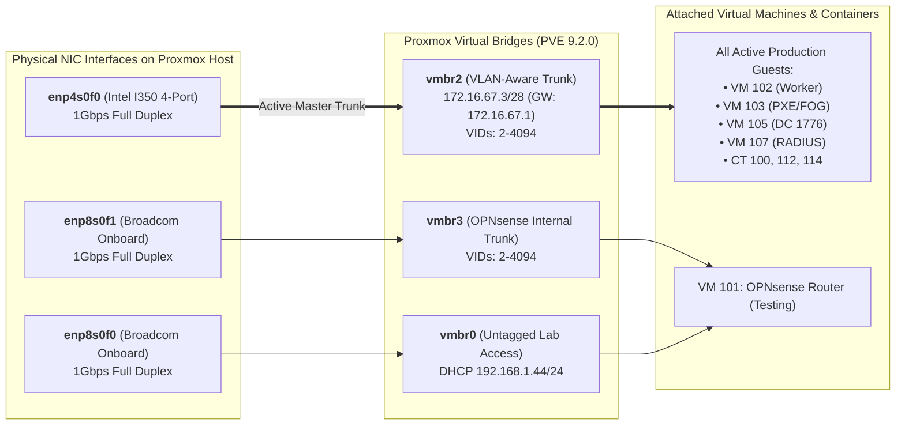
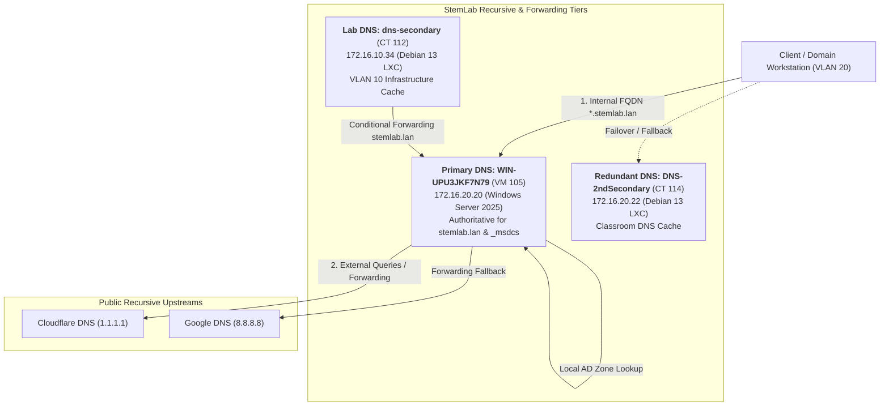
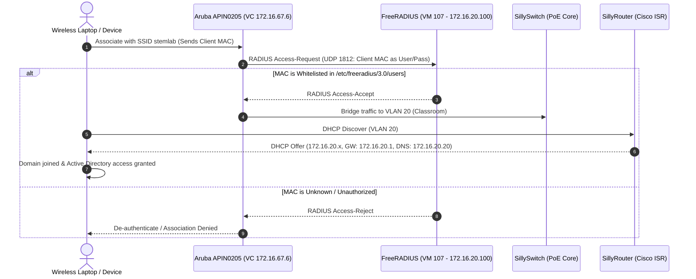
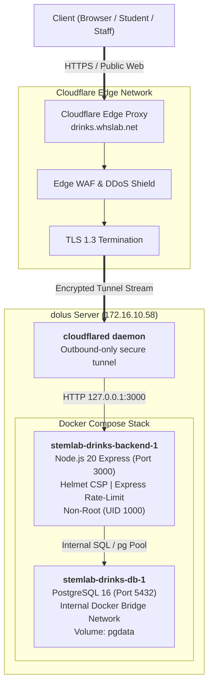
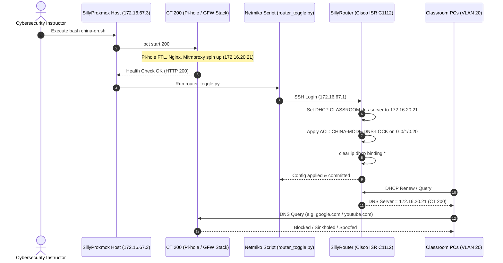
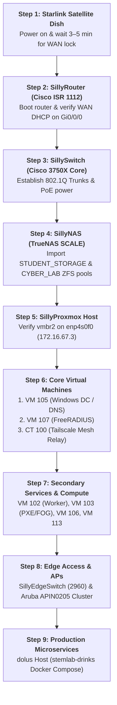

# WHS Cyber StemLab — Unified Master Documentation
**Current Academic Year:** 2025–2026  
**Last Updated:** November 2026 (Live Proxmox Investigation & Hardware Audit Verified)  
**Organization:** Wiesbaden High School Cyber Club ([Wiesbaden-Cyber](https://github.com/Wiesbaden-Cyber) / [team3011](https://github.com/team3011))  
**Primary Domain:** `stemlab.lan`  
**Public Service Domain:** `drinks.whslab.net`  
**WAN Uplink:** Starlink Satellite (CGNAT — no inbound port forwarding)  
**Remote Administration:** Tailscale VPN Mesh (`100.x.x.x`)

---

## Table of Contents

1. [Executive Summary & Evolution](#1-executive-summary--evolution)
2. [Master Network Architecture & Topology](#2-master-network-architecture--topology)
   - 2.1 [VLAN Segmentation & Addressing Plan](#21-vlan-segmentation--addressing-plan)
   - 2.2 [Physical & Logical Topology](#22-physical--logical-topology)
   - 2.3 [Core Hardware Inventory](#23-core-hardware-inventory)
   - 2.4 [Physical Cabling & Port Allocation](#24-physical-cabling--port-allocation)
   - 2.5 [Tailscale Remote Access Mesh](#25-tailscale-remote-access-mesh)
3. [Routing & Switching Core](#3-routing--switching-core)
   - 3.1 [Core Router: SillyRouter (Cisco ISR C1112)](#31-core-router-sillyrouter-cisco-isr-c1112)
   - 3.2 [Core Switch: SillySwitch (Cisco Catalyst 3750X-48P)](#32-core-switch-sillyswitch-cisco-catalyst-3750x-48p)
   - 3.3 [Classroom Switch: SillyEdgeSwitch (Cisco Catalyst 2960)](#33-classroom-switch-sillyedgeswitch-cisco-catalyst-2960)
   - 3.4 [DHCP & DNS Allocation Table](#34-dhcp--dns-allocation-table)
4. [Hypervisor Infrastructure: SillyProxmox (Live Audited)](#4-hypervisor-infrastructure-sillyproxmox-live-audited)
   - 4.1 [Host Hardware & OS Specifications](#41-host-hardware--os-specifications)
   - 4.2 [Linux Bridge & Active Trunk Migration (enp4s0 & vmbr2)](#42-linux-bridge--active-trunk-migration-enp4s0--vmbr2)
   - 4.3 [ZFS Storage Pools (NVMe + SAS)](#43-zfs-storage-pools-nvme--sas)
   - 4.4 [Complete VM Inventory (Audited)](#44-complete-vm-inventory-audited)
   - 4.5 [Complete Container Inventory (Audited)](#45-complete-container-inventory-audited)
   - 4.6 [Host Watchdog & Automated Resilience (Windows DC Recovery)](#46-host-watchdog--automated-resilience-windows-dc-recovery)
5. [Storage Infrastructure: SillyNAS (TrueNAS SCALE)](#5-storage-infrastructure-sillynas-truenas-scale)
   - 5.1 [Dual-NIC Network Architecture](#51-dual-nic-network-architecture)
   - 5.2 [ZFS Storage Pools & VDEVs](#52-zfs-storage-pools--vdevs)
   - 5.3 [Shares (SMB & NFS) and Encryption](#53-shares-smb--nfs-and-encryption)
6. [Active Directory & Identity: stemlab.lan](#6-active-directory--identity-stemlablan)
   - 6.1 [Domain Architecture & FSMO Roles](#61-domain-architecture--fsmo-roles)
   - 6.2 [User & Computer Account Conventions](#62-user--computer-account-conventions)
   - 6.3 [DNS Architecture & Multi-Tier Resolution](#63-dns-architecture--multi-tier-resolution)
   - 6.4 [Group Policy Objects (GPOs)](#64-group-policy-objects-gpos)
   - 6.5 [NTP Time Synchronization Architecture](#65-ntp-time-synchronization-architecture)
   - 6.6 [Trust Relationship & Break-Glass Local Admin Hardening](#66-trust-relationship--break-glass-local-admin-hardening)
7. [Wireless Infrastructure & 802.1X FreeRADIUS](#7-wireless-infrastructure--8021x-freeradius)
   - 7.1 [Aruba APIN0205 Instant AP Architecture](#71-aruba-apin0205-instant-ap-architecture)
   - 7.2 [TFTP Flashing & Instant OS Conversion](#72-tftp-flashing--instant-os-conversion)
   - 7.3 [FreeRADIUS MAC Authentication (VM107)](#73-freeradius-mac-authentication-vm107)
   - 7.4 [Aruba Virtual Controller Integration](#74-aruba-virtual-controller-integration)
8. [Production Services: stemlab-drinks Ordering System](#8-production-services-stemlab-drinks-ordering-system)
   - 8.1 [Service Overview & Endpoints](#81-service-overview--endpoints)
   - 8.2 [Container Architecture & Database Schema](#82-container-architecture--database-schema)
   - 8.3 [Cloudflare Tunnel & Public Ingress](#83-cloudflare-tunnel--public-ingress)
   - 8.4 [Security Hardening & Rate Limiting](#84-security-hardening--rate-limiting)
   - 8.5 [Operations & Management Commands](#85-operations--management-commands)
9. [Educational Simulation: China Mode (GFW Simulation)](#9-educational-simulation-china-mode-gfw-simulation)
   - 9.1 [Simulation Concept & Learning Goals](#91-simulation-concept--learning-goals)
   - 9.2 [CT 200 Stack (Pi-hole, Nginx, Mitmproxy)](#92-ct-200-stack-pi-hole-nginx-mitmproxy)
   - 9.3 [Automated Switchover Scripts & Cisco ACLs](#93-automated-switchover-scripts--cisco-acls)
   - 9.4 [Operational Verification & Maintenance](#94-operational-verification--maintenance)
10. [Standard Operating Procedures & Runbooks](#10-standard-operating-procedures--runbooks)
    - 10.1 [Bare-Metal Rebuild Order](#101-bare-metal-rebuild-order)
    - 10.2 [Client Domain Joining Guide (Windows 11 Pro)](#102-client-domain-joining-guide-windows-11-pro)
    - 10.3 [Domain Trust Failure Recovery Procedures](#103-domain-trust-failure-recovery-procedures)
    - 10.4 [Security Audit Trail & Maintenance Schedule](#104-security-audit-trail--maintenance-schedule)

---

## 1. Executive Summary & Evolution

The **WHS Cyber StemLab** provides an enterprise-grade computing and networking testbed for cybersecurity, robotics, and coding students at Wiesbaden High School. 

### From StemLab Mk2 to StemLab 25–26 Rebuild
- **Legacy Architecture (StemLab Mk2, 2023–2025):** Divided physically and logically between `Stemlab.lan` (`192.168.100.x`) and `Cyber.lan` (`172.16.1.x`) with dual pfSense firewalls, OpenMediaVault (OMV) storage, and fragmented Linksys access points. This caused routing loops, maintenance sprawl, and fragile domain trusts.
- **The Ground-Up Rebuild (2025–2026):** Following the 2024–2025 academic year, WHS Cyber leadership decommissioned the legacy stack to construct a unified, professional architecture centered on:
  1. A single authoritative routing core (**Cisco ISR C1112**) using IEEE 802.1Q subinterfaces.
  2. Enterprise Layer 2 PoE switching (**Cisco Catalyst 3750X & 2960**).
  3. Strict VLAN segmentation (Lab, Classroom, Guest, Management).
  4. Centralized enterprise hypervisor (**Proxmox VE 9.2.0**, Kernel `6.17.4-2-pve`) featuring high-speed NVMe storage and dedicated multi-port Intel I350 NICs.
  5. Unified network storage (**TrueNAS SCALE 25.04.2.6**).
  6. Authoritative Active Directory (`stemlab.lan`) powered by **Windows Server 2025** with automated break-glass resiliency and external Stratum-2 NTP synchronization.
  7. Centralized Aruba Instant 802.11ac wireless backed by **FreeRADIUS** MAC/802.1X authentication.
  8. Production containerized student services (`stemlab-drinks`) routed safely through Cloudflare Zero Trust Tunnels.

---

## 2. Master Network Architecture & Topology

### 2.1 VLAN Segmentation & Addressing Plan

| VLAN ID | Name | Subnet | Gateway / CIDR | Primary DNS | DHCP Scope / Helper | Purpose |
|:---:|:---|:---|:---|:---|:---|:---|
| **10** | **Lab** | `172.16.10.0/24` | `172.16.10.1` | `8.8.8.8`, `1.1.1.1` | `172.16.10.26`–`.254` (Opt 66/67) | Server infrastructure, dev VMs, worker nodes, iPXE boot, `dolus` drink server, secondary DNS. |
| **20** | **Classroom** | `172.16.20.0/24` | `172.16.20.1` | `172.16.20.20` (DC) | `172.16.20.26`–`.254` | Domain workstations (Z230 PCs, robotics laptops), AD services, TrueNAS data, Home Assistant. |
| **30** | **Guest** | `172.16.30.0/24` | `172.16.30.1` | `8.8.8.8`, `1.1.1.1` | `172.16.30.6`–`.254` | Isolated guest WiFi; internet egress only; strictly no inter-VLAN routing. |
| **67** | **Management**| `172.16.67.0/28` | `172.16.67.1` | `8.8.8.8`, `1.1.1.1` | Static only (`.1`–`.14`) | Out-of-band switches, router management, Proxmox host, TrueNAS web, AP VCs, Tailscale relay. |

### 2.2 Physical & Logical Topology


│ Data: 172.16.20.25  │                                    │ Fa0/1–Fa0/24 (Access VLAN 20)
└─────────────────────┘                         ┌──────────▼──────────┐
                                                │ Classroom Z230 PCs  │
                                                │ 172.16.20.x (DHCP)  │
                                                └─────────────────────┘
```

### 2.3 Core Hardware Inventory

| Device Name | Role | Hardware Platform | Operating System / Firmware | Management IP |
|:---|:---|:---|:---|:---|
| **SillyRouter** | Edge Router / DHCP / Inter-VLAN Gateway | Cisco ISR C1112-8PLTEEA | IOS XE 17.06.01a | `172.16.67.1` |
| **SillySwitch** | Core Distribution & PoE Switch | Cisco Catalyst WS-C3750X-48P | IOS 15.0(2)SE | `172.16.67.2` |
| **SillyEdgeSwitch** | Classroom Access Switch | Cisco Catalyst 2960-24TT-L | IOS 15.0(2)SE11 | `172.16.67.5` |
| **SillyProxmox** | Virtualization Hypervisor | Intel Xeon E5-2680 v3, 94 GB RAM, 2.77 TB ZFS | Proxmox VE 9.2.0 (Kernel `6.17.4-2-pve`) | `172.16.67.3` |
| **SillyNAS** | Enterprise Storage (SMB/NFS) | 4-bay x86_64 Server, 4x NICs | TrueNAS SCALE 25.04.2.6 | `172.16.67.4` (Mgmt) / `172.16.20.25` (Data) |
| **Aruba APs** | Wireless Access Cluster (x3+) | Aruba APIN0205 (Converted IAP) | ArubaOS 6.5.4.15 Taurus | `172.16.67.6` (Virtual Controller) |
| **dolus** | Bare-Metal/Dedicated Server | Ubuntu Workstation / Server | Ubuntu 24.04 LTS | `172.16.10.58` |

### 2.4 Physical Cabling & Port Allocation

| Local Device | Local Port | Remote Endpoint | Remote Port | Cable / Media | Configured Mode / VLAN |
|:---|:---|:---|:---|:---|:---|
| **Starlink Dish** | Ethernet Out | SillyRouter | `Gi0/0/0` | CAT6 UTP | WAN (DHCP via Starlink CGNAT) |
| **SillyRouter** | `Gi0/1/0` | SillySwitch | `Gi1/0/48` | CAT6 UTP | 802.1Q Trunk (10, 20, 30, 67 Native) |
| **SillySwitch** | `Gi1/0/25` | SillyProxmox | `enp4s0f0` | CAT6 UTP | 802.1Q Master Trunk (Carries `vmbr2`) |
| **SillySwitch** | `Gi1/0/26` | SillyNAS | `enp15s0` | CAT6 UTP | 802.1Q Trunk (VLAN 20 Data access) |
| **SillySwitch** | `Gi1/0/30` | SillyNAS | `enp14s0` | CAT6 UTP | Access VLAN 67 (Dedicated Mgmt NIC) |
| **SillySwitch** | `Gi1/0/27` | SillyEdgeSwitch | `Gi0/1` | CAT6 UTP | Trunk / Access VLAN 20 (Classroom link) |
| **SillySwitch** | `Gi1/0/1`–`4`, `43` | Aruba APs | RJ45 Ethernet | CAT6 PoE | Trunk (10, 20, 30, Native 67) |
| **SillySwitch** | `Gi1/0/10` | dolus | Host NIC | CAT6 UTP | Access VLAN 10 (Lab Network) |
| **SillyProxmox**| `enp8s0f0` | SillySwitch | `Gi1/0/12` | CAT6 UTP | Access VLAN 10 (`vmbr0` Untagged Lab) |

### 2.5 Tailscale Remote Access Mesh

Because Starlink provides only CGNAT IPv4 addresses with no inbound port forwarding, remote access is maintained via a persistent **Tailscale VPN Overlay Mesh**:


- **Management ACL Ingress:** Cisco switches and the core router enforce VTY SSH filtering allowing connections exclusively from the Management VLAN (`172.16.67.0/28`) and operator Tailscale IP (`100.83.36.66`).

---

## 3. Routing & Switching Core

### 3.1 Core Router: SillyRouter (Cisco ISR C1112)
- **Hostname:** `SillyRouter`
- **Firmware:** Cisco IOS XE Software, Version 17.06.01a (Serial: `FGL2644LYN2`)
- **WAN Interface:** `GigabitEthernet0/0/0` configured for `ip address dhcp` and `ip nat outside`.
- **LAN Trunk Interface:** `GigabitEthernet0/1/0` carrying 802.1Q subinterfaces:
  * `Gi0/1/0.10`: Encapsulation dot1Q 10 | IP `172.16.10.1 255.255.255.0`
  * `Gi0/1/0.20`: Encapsulation dot1Q 20 | IP `172.16.20.1 255.255.255.0`
  * `Gi0/1/0.30`: Encapsulation dot1Q 30 | IP `172.16.30.1 255.255.255.0`
  * `Gi0/1/0.67`: Encapsulation dot1Q 67 | IP `172.16.67.1 255.255.255.240`
- **Security Hardening:**
  * Brute-force throttling: `login block-for 60 attempts 3 within 30`
  * Strict VTY limits: `transport input ssh`, `exec-timeout 15 0`
  * Web management: HTTPS restricted to VLAN 67; HTTP completely disabled.
  * Specialized Ingress ACL `DOLUS-RESTRICT` applied to `Vlan10` blocking server `172.16.10.58` from accessing Proxmox web GUI at `172.16.67.3:8006`.

### 3.2 Core Switch: SillySwitch (Cisco Catalyst 3750X-48P)
- **Model:** WS-C3750X-48P-L (48 Gigabit PoE Ports, Serial: `FDO1436K1FE`)
- **Firmware:** Cisco IOS 15.0(2)SE
- **VTP Configuration:** Transparent mode (`vtp mode transparent`)
- **Spanning Tree:** Rapid-PVST with BPDU Guard error-recovery enabled.
- **Management SVI:** `interface Vlan67` with IP `172.16.67.2 255.255.255.240`, default gateway `172.16.67.1`.
- **Trunk Ports:** `GigabitEthernet1/0/1` through `1/0/4`, `1/0/25`, `1/0/26`, `1/0/48` set to `switchport trunk encapsulation dot1q` and `switchport mode trunk`.

### 3.3 Classroom Switch: SillyEdgeSwitch (Cisco Catalyst 2960)
- **Model:** Catalyst 2960-24TT-L (Serial: `FOC1124Z11B`)
- **Firmware:** Cisco IOS 15.0(2)SE11
- **Management SVI:** `interface Vlan67` with IP `172.16.67.5 255.255.255.240`.
- **Access Ports:** `FastEthernet0/1` through `0/24` statically assigned to `switchport access vlan 20`, `spanning-tree portfast`, and `spanning-tree bpduguard enable`.

### 3.4 DHCP & DNS Allocation Table

```cisco
! Excluded Static Allocations
ip dhcp excluded-address 172.16.10.1 172.16.10.25    ! Lab Infrastructure
ip dhcp excluded-address 172.16.10.58                ! dolus (drinks service)
ip dhcp excluded-address 172.16.10.60                ! velocitee VM 110
ip dhcp excluded-address 172.16.10.61                ! WazuhSIEM VM 111
ip dhcp excluded-address 172.16.10.34                ! dns-secondary CT 112
ip dhcp excluded-address 172.16.20.1 172.16.20.25    ! Classroom Infrastructure
ip dhcp excluded-address 172.16.20.22                ! DNS-2ndSecondary CT 114
ip dhcp excluded-address 172.16.20.100               ! FreeRADIUS CA Server
ip dhcp excluded-address 172.16.30.1 172.16.30.5     ! Guest AP Gateways
ip dhcp excluded-address 172.16.67.1 172.16.67.15    ! All VLAN 67 Management (Static Only)

! Pool Definitions
ip dhcp pool LAB
 network 172.16.10.0 255.255.255.0
 default-router 172.16.10.1
 dns-server 8.8.8.8 1.1.1.1
 option 66 ascii 172.16.10.3                         ! iPXE Server
 option 67 ascii ipxe.efi

ip dhcp pool CLASSROOM
 network 172.16.20.0 255.255.255.0
 default-router 172.16.20.1
 dns-server 172.16.20.20 8.8.8.8 1.1.1.1             ! Primary: Windows DC DNS

ip dhcp pool GUEST
 network 172.16.30.0 255.255.255.0
 default-router 172.16.30.1
 dns-server 8.8.8.8 1.1.1.1
```

---

## 4. Hypervisor Infrastructure: SillyProxmox (Live Audited)

### 4.1 Host Hardware & OS Specifications
- **Hostname:** `pve` (FQDN: `pve.lab`)
- **OS Version:** Proxmox VE **9.2.0** (PVE Manager version `9.2.3/d0fde103346cf89a`, Debian 13 "Trixie" base)
- **Linux Kernel:** `6.17.4-2-pve`
- **CPU:** Intel(R) Xeon(R) CPU E5-2680 v3 @ 2.50GHz (1 Socket, 12 Cores / 24 Threads)
- **RAM:** 94 GiB Total (51 GiB Active Allocations, 43 GiB Buffer/Available, Swap: 0B)
- **Primary Host IP:** `172.16.67.3/28` (Web GUI: `https://172.16.67.3:8006`)

### 4.2 Linux Bridge & Active Trunk Migration (`enp4s0` & `vmbr2`)



During recent infrastructure enhancements, a **4-port Intel I350 NIC** was installed (`enp4s0f0`–`enp4s0f3`) to offload hypervisor management and VM traffic. As verified from live `/etc/network/interfaces`:

- **`vmbr2` (Active Management Trunk):** Connected to `enp4s0f0`, statically assigned `172.16.67.3/28` (Gateway `172.16.67.1`). It is VLAN-aware (`bridge-vids 2-4094`) and carries all production VM/LXC tagged traffic.
- **`vmbr1` (Legacy Trunk):** Commented out in `/etc/network/interfaces`. All virtual machines and containers have been fully migrated to `vmbr2`.
- **`vmbr0` (Untagged Lab Access):** Bound to `enp8s0f0` pulling DHCP address `192.168.1.44/24`.
- **`vmbr3` (OPNsense Dev Trunk):** Configured on `enp8s0f1` as a VLAN-aware bridge for internal firewall experiments.

```ini
# /etc/network/interfaces (Audited Live)
auto lo
iface lo inet loopback

# 2-port Intel I350 (Stage 2 OPNsense)
auto enp8s0f0
iface enp8s0f0 inet manual

auto enp8s0f1
iface enp8s0f1 inet manual

# 4-port Intel I350 (Taking over Proxmox management roles)
auto enp4s0f0
iface enp4s0f0 inet manual

auto vmbr0
iface vmbr0 inet dhcp
    bridge-ports enp8s0f0
    bridge-stp off
    bridge-fd 0

auto vmbr2
iface vmbr2 inet static
    address 172.16.67.3/28
    gateway 172.16.67.1
    bridge-ports enp4s0f0
    bridge-stp off
    bridge-fd 0
    bridge-vlan-aware yes
    bridge-vids 2-4094

auto vmbr3
iface vmbr3 inet manual
    bridge-ports enp8s0f1
    bridge-stp off
    bridge-fd 0
    bridge-vlan-aware yes
    bridge-vids 2-4094
```

### 4.3 ZFS Storage Pools (NVMe + SAS)
- **Pool Name:** `rpool` (Status: `ONLINE`, 0 errors, last scrubbed Oct 2026)
- **Raw Pool Size:** 2.77 TB (246 GB Allocated for VMs/LXCs, 2.41 TB Free)
- **Underlying Disks:**
  * `nvme0n1`: 953.9 GB NVMe SSD (`part3`)
  * `nvme1n1`: 953.9 GB NVMe SSD (`part3`)
  * `sda`: 1.1 TB SAS/SCSI Enterprise SSD (`part3`)
- **Proxmox Datastores:**
  * `local`: Directory datastore at `/var/lib/vz` (ISOs, backups, templates, snippets).
  * `local-zfs`: Thin-provisioned ZFS dataset at `rpool/data` (LXC subvols and VM raw zvols).

### 4.4 Complete VM Inventory (Audited)

| VMID | Name | Status | vCPU | RAM | Disk | Bridge / VLAN | Assigned IP | Boot | Role & Purpose |
|:---:|:---|:---:|:---:|:---:|:---:|:---:|:---|:---:|:---|
| **101** | `OPNsense-Redstone` | Stopped | 4 (2s×2c) | 8 GB | 32 GB | `vmbr0`, `vmbr3`, `vmbr2` | DHCP / Internal | `onboot: 1` | Experimental virtual firewall and captive portal sandbox. |
| **102** | `Worker-1` | **Running** | 14 cores | 16 GB | 150 GB | `vmbr2` (VLAN 10) | `172.16.10.82` (DHCP) | `onboot: 1` | High-compute worker node for compilation, automated builds, and testing. |
| **103** | `PXE` | **Running** | 1 core | 4 GB | 40 GB | `vmbr2` (VLAN 10) | `172.16.10.3` (Static) | `onboot: 0` | Debian 13 iPXE / TFTP netboot server for student PC imaging. |
| **104** | `DO-Local-Ubuntu-Server` | Stopped | 4 (2s×2c) | 8 GB | 40 GB | `vmbr2` (VLAN 10) | `172.16.10.x` | `onboot: 1` | Ubuntu 24.04 local developer sandbox. |
| **105** | `WindowsServer1776` | **Running** | 9 (3s×3c) | 8 GB | 70 GB | `vmbr2` (VLAN 20) | `172.16.20.20` (Static) | `onboot: 1` | **Primary Domain Controller (`stemlab.lan`)**, AD DS, DNS, File Server. Monitored by watchdog. |
| **106** | `UBUNTU-SERVER` | **Running** | 4 (2s×2c) | 8 GB | 32 GB | `vmbr2` (VLAN 20) | `172.16.20.x` (DHCP) | `onboot: 1` | Re-provisioned Ubuntu Server 24.04 general services host (formerly ADDC). |
| **107** | `FreeRADIUS-CA` | **Running** | 4 (2s×2c) | 8 GB | 32 GB | `vmbr2` (VLAN 20) | `172.16.20.100` (Static)| `onboot: 1` | FreeRADIUS 3.0 authentication engine + Local Certificate Authority. |
| **108** | `VM 108` | Stopped | 4 cores | 2 GB | 24 GB | `vmbr2` (VLAN 10) | DHCP | `onboot: 0` | Ubuntu 24.04 utility VM. |
| **109** | `CDS-n8n` | Stopped | 1 core | 16 GB | 40 GB | `vmbr2` (VLAN 10) | `172.16.10.x` | `onboot: 1` | n8n workflow automation platform for club operations. |
| **110** | `velocitee` | Stopped | 2 cores | 4 GB | 20 GB | `vmbr2` (VLAN 10) | `172.16.10.60` (Static) | `onboot: 1` | Velocitee provisioning engine node. |
| **111** | `WazuhSIEM` | Stopped | 8 cores | 16 GB | 100 GB | `vmbr2` (VLAN 10) | `172.16.10.61` (Static) | `onboot: 0` | Wazuh SIEM appliance for centralized security log collection. |
| **113** | `homeassistant` | **Running** | 2 cores | 8 GB | 50 GB | `vmbr2` (VLAN 20) | `172.16.20.x` (DHCP) | `onboot: 1` | Home Assistant OS IoT controller for smart lab hardware. |

### 4.5 Complete Container Inventory (Audited)

| VMID | Hostname | Status | Cores | RAM | Rootfs | Bridge / VLAN | Assigned IP | Boot | Operational Role |
|:---:|:---|:---:|:---:|:---:|:---:|:---:|:---|:---:|:---|
| **100** | `Tailscale` | **Running** | 1 | 256 MB | 12 GB | `vmbr2` | `172.16.67.9/28` (LAN)<br>`100.112.34.75` (Tailscale) | `onboot: 1` | Subnet relay node providing remote admin access into `172.16.67.0/28`. Unprivileged, TUN passthrough. |
| **112** | `dns-secondary` | **Running** | 1 | 512 MB | 8 GB | `vmbr2` | `172.16.10.34/24` (VLAN 10) | `onboot: 0` | Secondary internal DNS resolver node on the Lab network. |
| **114** | `DNS-2ndSecondary`| **Running** | 3 | 512 MB | 8 GB | `vmbr2` | `172.16.20.22/24` (VLAN 20) | `onboot: 0` | Redundant secondary DNS resolver node on the Classroom network. |
| **200** | `Pi-hole` | Stopped | 2 | 1024 MB| 8 GB | `vmbr2` (VLAN 20) | `172.16.20.21/24` (Static) | `onboot: 0` | Core DNS sinkhole for "China Mode" GFW CTF educational simulations. |

### 4.6 Host Watchdog & Automated Resilience (Windows DC Recovery)

To prevent domain service outages caused by unexpected shutdowns or resource exhaustion on VM 105 (`WindowsServer1776`), an automated watchdog daemon runs on the Proxmox host:

- **Watchdog Script (`/root/auto_restart_windows.sh`):**
  ```bash
  #!/bin/bash
  VMID="105"

  # Check if the Windows DC VM is currently stopped
  if ! qm status $VMID | grep -q "running"; then
      echo "Windows Server VM $VMID is stopped. Booting it back up..."
      /usr/sbin/qm start $VMID
  fi
  ```
- **Automated Scheduling:** Enforced via root crontab on `pve`:
  ```cron
  * * * * * /root/auto_restart_windows.sh >/dev/null 2>&1
  ```
  Runs every 60 seconds, ensuring zero extended downtime for Active Directory, DNS, and student home shares.

---

## 5. Storage Infrastructure: SillyNAS (TrueNAS SCALE)

### 5.1 Dual-NIC Network Architecture
SillyNAS runs **TrueNAS SCALE 25.04.2.6** and physically enforces network segregation between administrative operations and student file transfers:
- **`enp14s0` (Management):** Connected to access port on VLAN 67 (`172.16.67.4/28`). Handles TrueNAS Web GUI (`https://172.16.67.4`) and administrative SSH.
- **`enp15s0` (Classroom Data):** Connected to VLAN 20 trunk (`172.16.20.25/24`). Handles high-bandwidth SMB file transfers from domain PCs.
- **`enp16s0` & `enp17s0`:** Reserved interfaces (currently administratively down).

### 5.2 ZFS Storage Pools & VDEVs
1. **`STUDENT_STORAGE` Pool:**
   - Configuration: **4-Disk RAIDZ1** (`sda`, `sdb`, `sdc`, `sdd`).
   - Mount Point: `/mnt/STUDENT_STORAGE`
   - Purpose: Multi-terabyte student home storage resilient against single-drive mechanical failure.
2. **`CYBER_LAB` Pool:**
   - Configuration: **Single High-Performance Disk** (`sde`).
   - Mount Point: `/mnt/CYBER_LAB`
   - Purpose: Ephemeral scratch storage, fast package mirrors, and build caches.

### 5.3 Shares (SMB & NFS) and Encryption
- **`\\SILLYNAS\student_homes` (`/mnt/STUDENT_STORAGE/homes`):** Automatically mounted as network home drives for all domain users via Active Directory GPO.
- **`\\SILLYNAS\shared` (`/mnt/STUDENT_STORAGE/shared`):** Shared collaborative directory for coursework and club resources.
- **`nfs://172.16.10.x/mnt/CYBER_LAB/APT_CACHE`:** NFS export serving as an APT package cache for rapid PXE and VM provisioning.
- **Enforced SMB Transport Encryption:** Hardened on 2026-03-23. TrueNAS enforces **SMB3 transport encryption and mandatory packet signing**. Unencrypted legacy SMB dialects are rejected.

---

## 6. Active Directory & Identity: stemlab.lan

### 6.1 Domain Architecture & FSMO Roles
- **Active Directory FQDN:** `stemlab.lan` (NetBIOS: `STEMLAB`)
- **Domain & Forest Functional Level:** Windows Server 2025
- **Primary Domain Controller:** `WIN-UPU3JKF7N79` (VM 105, `172.16.20.20`)
- **FSMO Role Holders:** All 5 Operations Master roles (Schema Master, Domain Naming Master, PDC Emulator, RID Master, Infrastructure Master) are actively held by `WIN-UPU3JKF7N79.stemlab.lan`.

### 6.2 User & Computer Account Conventions
- **Student Account Schema:** ~500+ student accounts provisioned directly into `CN=Users,DC=stemlab,DC=lan` following the standard academic pattern: `[FirstInitial][3-Char Surname][4-Digit ID]` (e.g., `arin3449`, `jdav8803`).
- **Domain Administrative Accounts:**
  * `Administrator`: Primary built-in Domain Admin.
  * `teststudent`: Evaluation student account for login tests.
  * `Guest` and `krbtgt`: Built-in accounts (disabled for security).
- **Computer Naming Conventions:**
  * `Z230-###`: Classroom HP Z230 workstations (VLAN 20).
  * `ROBOTICS-###`: Mobile coding and robotics Dell laptops (VLAN 20).
  * `DESKTOP-Z230-###`: Specialized lab benches (VLAN 10).

### 6.3 DNS Architecture & Multi-Tier Resolution



- **Primary Resolver (VLAN 20):** Windows Server DNS runs on `172.16.20.20` (`WIN-UPU3JKF7N79`).
  * Authoritative for `stemlab.lan` and `_msdcs.stemlab.lan`.
  * Reverse lookup zones for `172.16.20.x` and `172.16.10.x`.
- **Secondary Resolvers (Containers):**
  * `dns-secondary` (CT 112, `172.16.10.34`): Lab network cache and secondary resolver.
  * `DNS-2ndSecondary` (CT 114, `172.16.20.22`): Classroom network redundant resolver.
- **External Forwarders:** Public recursive resolvers (`1.1.1.1`, `8.8.8.8`).

### 6.4 Group Policy Objects (GPOs)

| GPO Name | Target OU / Scope | Enforcement Date | Description & Policy Settings |
|:---|:---|:---:|:---|
| **Default Domain Policy** | `DC=stemlab,DC=lan` | 2026-02-12 | Base domain security, Kerberos ticket policies, account lockout thresholds. |
| **Default Domain Controllers** | `OU=Domain Controllers` | 2026-02-12 | Kerberos encryption types, DC auditing, audit log sizes. |
| **Student Home Drive** | Authenticated Users | 2026-03-12 | Auto-mounts network drive `H:` to `\\SILLYNAS\student_homes\%USERNAME%`. |
| **Network File Sharing** | Domain Computers | 2026-03-12 | Opens Windows Firewall rules for SMB (TCP 445) and Network Discovery across VLAN 20. |
| **Stemlab - Machine Account Hardening** | Domain Computers | 2026-05-01 | Sets `HKLM\SYSTEM\CurrentControlSet\Services\Netlogon\Parameters\MaximumPasswordAge = 120` (prevents desync on laptops). |
| **Stemlab - Local Admin Enforcement** | Domain Computers | 2026-05-01 | Executes `\\stemlab.lan\NETLOGON\enforce-local-admin.ps1` at startup to ensure break-glass `admin` account exists. |

### 6.5 NTP Time Synchronization Architecture
Prior to May 2026, the PDC emulator was in a free-running state, drifting by up to 18.8 seconds and causing Kerberos clock-skew authentication rejections ("trust relationship failed").

**Authoritative NTP Implementation (Applied 2026-05-01):**
The PDC Emulator (`WIN-UPU3JKF7N79`) is configured as an authoritative Stratum-1/Stratum-2 time source syncing with European Stratum-1 atomic clocks:
```powershell
w32tm /config /manualpeerlist:"de.pool.ntp.org,0x9 ptbtime1.ptb.de,0x9 ptbtime2.ptb.de,0x9 time.cloudflare.com,0x9" /syncfromflags:manual /reliable:yes /update
Stop-Service w32time
Start-Service w32time
w32tm /resync /rediscover
```
- **Domain Clients:** All member workstations sync automatically with the PDC via the Windows Time Hierarchy (`Type=NT5DS`).
- **Verification Command:** `w32tm /query /source` returns `ptbtime2.ptb.de,0x9` or `de.pool.ntp.org,0x9` (never `Free-running System Clock`).

### 6.6 Trust Relationship & Break-Glass Local Admin Hardening

To permanently resolve trust breakage when student laptops sit offline for extended breaks:
1. **Machine Password Age Extended:** Increased from default 30 days to **120 days** via GPO.
2. **Break-Glass Local Admin GPO (`enforce-local-admin.ps1`):**
   - Automatically runs at computer startup.
   - Intentionally detects and skips Domain Controllers (`DomainRole` 4/5) to prevent accidental Active Directory user pollution.
   - Idempotently creates or updates the local user `admin`.
   - Forces password expiration off (`PasswordNeverExpires = $true`).
   - Injects the account into the local Administrators group using well-known SID `S-1-5-32-544` (ensuring language and locale independence).
   - Writes diagnostic execution traces to `C:\Windows\Temp\stemlab-local-admin.log`.

---

## 7. Wireless Infrastructure & 802.1X FreeRADIUS

### 7.1 Aruba APIN0205 Instant AP Architecture
The StemLab wireless environment is powered by enterprise **Aruba APIN0205** access points configured as an autonomous **Instant Access Point (IAP)** cluster. One AP acts as the dynamic Virtual Controller (VC) at `172.16.67.6`.



### 7.2 TFTP Flashing & Instant OS Conversion
To convert surplus enterprise campus APs into autonomous Instant APs:
1. Connect via RJ45 rollover console cable (9600 baud, 8N1).
2. Set host workstation to static IP `192.168.1.10` and start a TFTP service hosting `ArubaInstant_Taurus_6.5.4.15_73677`.
3. Interrupt apboot sequence:
   ```text
   apboot> setenv ipaddr 192.168.1.20
   apboot> setenv netmask 255.255.255.0
   apboot> setenv serverip 192.168.1.10
   apboot> upgrade os 0 ArubaInstant_Taurus_6.5.4.15_73677
   apboot> upgrade os 1 ArubaInstant_Taurus_6.5.4.15_73677
   apboot> proginv system ccode CCODE-RW-de6fdb363ff04c13ee261ec04fbb01bdd482d1cd
   apboot> invent -w
   apboot> factory_reset
   apboot> saveenv
   apboot> boot
   ```
4. Master Election: Run `iap-master` on the primary unit. The cluster forms automatically and broadcasts configuration across all APs in the management VLAN.

### 7.3 FreeRADIUS MAC Authentication (VM107)
FreeRADIUS 3.0 runs on **VM107** (`172.16.20.100`) providing MAC-level access control for protected wireless networks.
- **Client Configuration (`/etc/freeradius/3.0/clients.conf`):**
  ```text
  client ArubaVC {
    ipaddr = 172.16.67.6
    secret = <RADIUS_SHARED_SECRET>
    require_message_authenticator = no
  }
  ```
- **MAC Whitelist Database (`/etc/freeradius/3.0/users`):**
  ```text
  # MAC in uppercase hex without colons
  AABBCCDDEEFF   Cleartext-Password := "AABBCCDDEEFF"
  ```
- **Live Reload:** `sudo systemctl kill -s HUP freeradius`

### 7.4 Aruba Virtual Controller Integration
- **SSID Mapping:**
  * `stemlab-secure`: VLAN 20, WPA2-Enterprise / MAC authentication through VM107.
  * `stemlab-guest`: VLAN 30, WPA2-PSK, isolated to internet access only.
  * `stemlab-iot`: VLAN 10, WPA2-PSK, dedicated to robotics controllers and ESP32s.

---

## 8. Production Services: stemlab-drinks Ordering System

### 8.1 Service Overview & Endpoints
The `stemlab-drinks` system is a custom production web application facilitating student drink purchases and staff inventory fulfillment.
- **Repository:** [`Wiesbaden-Cyber/stemlab-drinks`](https://github.com/Wiesbaden-Cyber/stemlab-drinks)
- **Host Server:** `dolus` (Ubuntu 24.04 LTS, `172.16.10.58`)
- **Public URL:** `https://drinks.whslab.net` (Cloudflare Tunnel)
- **Internal URL:** `http://172.16.10.58:3000` (Restricted to localhost / tunnel)
- **Web Interfaces:**
  * `/`: Student ordering portal (menu, cart, submission).
  * `/staff.html`: Real-time order fulfillment queue (PIN protected).
  * `/menu.html`: Live pricing, inventory toggles, drink additions (PIN protected).
  * `/inventory.html`: Bulk ordering interface for events (PIN protected).

### 8.2 Container Architecture & Database Schema
Managed via Docker Compose (`/home/ferry/stemlab-drinks/compose.yml`):
- **Backend Container (`stemlab-drinks-backend-1`):** Node.js 20 Alpine, Express, Helmet, express-rate-limit.
- **Database Container (`stemlab-drinks-db-1`):** PostgreSQL 16 on internal bridge network (`pgdata` volume).



**PostgreSQL Schema:**
- `drinks`: `id`, `name` (UNIQUE), `price` (NUMERIC), `is_available` (BOOL), `sort_order` (INT), `category`, `notes`.
- `orders`: `id`, `order_number` (BIGINT, starts at 1000), `customer_name`, `total_cost`, `status` (`new`, `in_progress`, `fulfilled`, `cancelled`), `created_at`, `fulfilled_at`.
- `order_items`: Snapshots `drink_name` and `unit_price` at moment of purchase to preserve financial records even if the live menu price changes.

### 8.3 Cloudflare Tunnel & Public Ingress
Inbound traffic is received through a secure outbound-only `cloudflared` daemon on `dolus`. No ports are opened on the Starlink WAN. Cloudflare terminates TLS at edge and proxies directly to `127.0.0.1:3000`.

### 8.4 Security Hardening & Rate Limiting
- **Port Binding:** Bound exclusively to `127.0.0.1:3000:3000` in `compose.yml`. Direct LAN access on port 3000 is blocked.
- **Proxy Trust:** `app.set('trust proxy', 1)` enables accurate client IP parsing from `X-Forwarded-For`.
- **Rate Limiting:**
  * Admin PIN attempts: 5 requests / IP / 15 minutes.
  * Order placement: 20 orders / IP / 10 minutes.
- **PIN Failure Protection (Patched 2026-07-22):** App throws an exception at boot if `ADMIN_PIN` is missing from `.env`, eliminating silent fallbacks to default values.
- **Least Privilege:** Node.js app runs as non-root UID `1000:1000`. User `ferry` removed from `lxd` group on host.
- **Cisco Router ACL:** `DOLUS-RESTRICT` prevents `dolus` from connecting to Proxmox port 8006.

### 8.5 Operations & Management Commands

```bash
# Connect to host
ssh ferry@172.16.10.58

# Check stack status
cd /home/ferry/stemlab-drinks && docker compose ps

# Live container logs
docker logs stemlab-drinks-backend-1 -f

# Rebuild and restart application
docker compose down && docker compose up -d --build

# Query current open orders
docker exec -it stemlab-drinks-db-1 psql -U stemlab -d stemlab \
  -c "SELECT order_number, customer_name, total_cost, status, created_at FROM orders WHERE status='new' ORDER BY created_at;"
```

---

## 9. Educational Simulation: China Mode (GFW Simulation)

### 9.1 Simulation Concept & Learning Goals
"China Mode" is an educational Great Firewall (GFW) simulator designed for cybersecurity classes and CTF challenges. When activated, VLAN 20 (Classroom) experiences simulated national-scale internet filtering, DNS spoofing, geo-spoofing, and ad injection—while internal domain operations (`stemlab.lan`) remain operational.

### 9.2 CT 200 Stack (Pi-hole, Nginx, Mitmproxy)
- **Container:** Proxmox CT 200 (Debian 13, 2 vCPU, 1 GB RAM, IP `172.16.20.21`, static, `onboot: 0`).
- **Pi-hole FTL (`:53`):**
  * Blocks hundreds of domains from `blocklist-gfw.txt` (Google, YouTube, social media, major foreign news, VPN providers).
  * Upstream resolver: Alibaba Cloud DNS (`223.5.5.5` / `223.6.6.6`).
  * Conditional Forwarding: `stemlab.lan` and reverse lookups (`20.16.172.in-addr.arpa`) forward to Domain Controller `172.16.20.20`.
- **Nginx (`:80`):** Injects Chinese geolocation headers (`X-Forwarded-For: 61.135.169.125`, `CF-IPCountry: CN`, `Accept-Language: zh-CN`).
- **Mitmproxy (`:8081`):** Injects Baidu-style banner advertisements into unencrypted HTTP responses using `inject_ads.py`.

### 9.3 Automated Switchover Scripts & Cisco ACLs

Switching China Mode on or off is automated via Python Netmiko scripts located on Proxmox at `/opt/china-mode/scripts/`:



**Cisco Router Configuration Toggled Dynamically:**
```cisco
! Applied during China Mode ON
ip access-list extended CHINA-MODE-DNS-LOCK
 10 permit udp any host 172.16.20.21 eq 53
 20 permit tcp any host 172.16.20.21 eq 53
 30 deny   udp any any eq 53 log
 40 deny   tcp any any eq 53 log
 50 permit ip any any
!
interface Vlan20
 ip access-group CHINA-MODE-DNS-LOCK in
!
ip dhcp pool CLASSROOM
 no dns-server
 dns-server 172.16.20.21
```

### 9.4 Operational Verification & Maintenance
- **Activation:** `bash /opt/china-mode/scripts/china-on.sh`
- **Deactivation:** `bash /opt/china-mode/scripts/china-off.sh`
- **Client Testing (from VLAN 20 PC):**
  * `nslookup google.com` → Resolves to `0.0.0.0` (Blocked).
  * `nslookup baidu.com` → Resolves successfully via Alibaba DNS.
  * `nslookup stemlab.lan` → Resolves to `172.16.20.20` (Domain controller verified).

---

## 10. Standard Operating Procedures & Runbooks

### 10.1 Bare-Metal Rebuild Order
When recovering the laboratory from a total power outage or hardware refresh, restore devices in this sequence:



1. **Starlink Satellite Dish:** Power on and wait 3–5 minutes for satellite lock.
2. **SillyRouter (Cisco ISR 1112):** Boot router; verify WAN acquisition on `Gi0/0/0`.
3. **SillySwitch (Cisco 3750X):** Power on core switch; confirm trunks establish on port 48.
4. **SillyNAS (TrueNAS SCALE):** Power on storage server; verify ZFS pool import and SMB services.
5. **SillyProxmox:** Boot hypervisor; verify `vmbr2` static IP `172.16.67.3` on `enp4s0f0`.
6. **Core Proxmox VMs & Containers:**
   - Auto-starts VM 105 (`WindowsServer1776`). Monitored by `/root/auto_restart_windows.sh`. Verify DNS on port 53.
   - Auto-starts VM 107 (`FreeRADIUS`).
   - Auto-starts CT 100 (`Tailscale`).
   - Auto-starts VM 102 (`Worker-1`), VM 106 (`UBUNTU-SERVER`), VM 113 (`homeassistant`).
7. **SillyEdgeSwitch (Cisco 2960):** Power on classroom switch.
8. **Aruba Wireless APs:** Power on PoE ports; confirm Virtual Controller synchronization.
9. **dolus (`stemlab-drinks`):** Confirm Docker Compose stack startup.

### 10.2 Client Domain Joining Guide (Windows 11 Pro)
1. Verify workstation is running **Windows 11 Pro** (Windows 11 Home is incompatible).
2. Connect to network cable on VLAN 20 or join `stemlab-secure` WiFi.
3. Open PowerShell as Administrator and verify DNS resolution:
   ```powershell
   Resolve-DnsName stemlab.lan
   ```
4. Navigate to **Settings → System → About → Domain or Workgroup → Change**.
5. Select **Domain**, enter `stemlab.lan`.
6. Enter Domain Administrator credentials.
7. Click **OK** and restart the workstation.
8. Upon reboot, sign in using student account format `STEMLAB\arin3449`. The `H:` drive will mount automatically.

### 10.3 Domain Trust Failure Recovery Procedures
If a workstation fails with *"The trust relationship between this workstation and the primary domain failed"*:

#### Option A: Break-Glass Administrative Reset (Recommended)
1. Sign in to the workstation using the local break-glass account:
   - Username: `.\admin`
   - Password: (Retrieved from operator password manager or `\\stemlab.lan\NETLOGON\enforce-local-admin.ps1`)
2. Open PowerShell as Administrator:
   ```powershell
   $cred = Get-Credential STEMLAB\Administrator
   Reset-ComputerMachinePassword -Server win-upu3jkf7n79.stemlab.lan -Credential $cred
   Restart-Computer
   ```

#### Option B: Clean Domain Rejoin
```powershell
# Unjoin machine
Remove-Computer -UnjoinDomainCredential STEMLAB\Administrator -PassThru -Restart -Force

# After reboot, sign in as .\admin and rejoin
Add-Computer -DomainName "stemlab.lan" -Credential STEMLAB\Administrator -Restart
```

### 10.4 Security Audit Trail & Maintenance Schedule

| Component | Maintenance Task | Cadence | Procedure |
|:---|:---|:---:|:---|
| **Domain Controller** | NTP Source Audit | Monthly | `w32tm /query /source` must show external NTP pool, never local clock. |
| **DC Watchdog** | Script & Cron Verification | Monthly | Verify `/root/auto_restart_windows.sh` runs via cron; verify `qm status 105`. |
| **Active Directory** | Stale Computer Cleanup | Quarterly | Run `Get-ADComputer -Filter * -Properties PasswordLastSet` to prune decommissioned PCs. |
| **Local Admin Password** | Break-Glass Password Rotation | Bi-Annually | Update password in `\\stemlab.lan\NETLOGON\enforce-local-admin.ps1`. |
| **dolus / drinks** | Order Database Vacuum & Prune | Monthly | Verify 24h retention auto-purge job; check database size with `psql`. |
| **FreeRADIUS** | MAC Whitelist Review | Semesterly | Audit `/etc/freeradius/3.0/users` against student equipment return sheets. |
| **Proxmox & TrueNAS** | Storage Pool Scrub | Monthly | Execute `zpool scrub rpool` (PVE) and scheduled scrub on `STUDENT_STORAGE` (TrueNAS). |

---
*Documentation compiled and maintained for the WHS Cyber Club infrastructure operations.*
